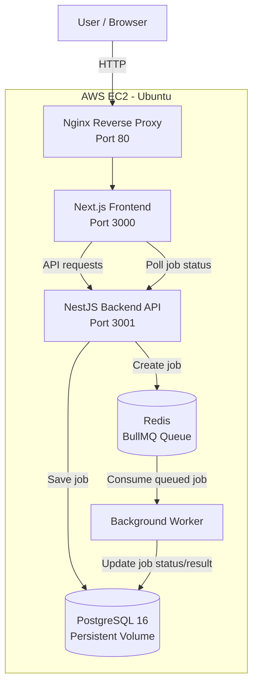
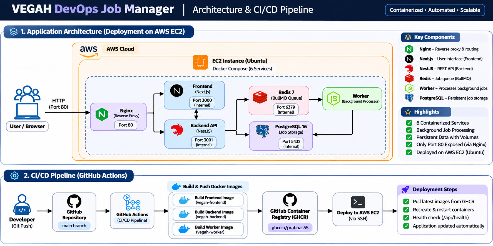
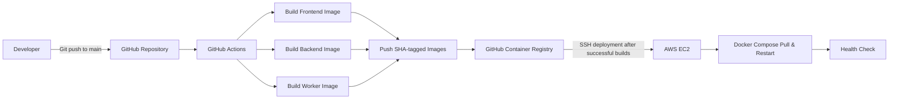

# VEGAH DevOps Job Manager

A containerized job-processing application deployed on AWS EC2 using Docker Compose, GitHub Actions and GitHub Container Registry (GHCR).

The application allows users to submit background jobs through a web interface. Jobs are queued using Redis and BullMQ, processed by a dedicated Node.js worker, and their results are stored in PostgreSQL.

## Live Deployment

- **Application:** http://65.1.148.118
- **GitHub Repository:** https://github.com/Prabhas55/vegah-devops-cloud-assessment
- **Cloud Provider:** AWS EC2
- **Container Registry:** GitHub Container Registry (GHCR)

## Technology Stack

| Component | Technology |
|---|---|
| Frontend | Next.js |
| Backend | NestJS |
| Database | PostgreSQL 16 |
| Queue | Redis 7 |
| Background Processing | BullMQ, Node.js |
| Containerization | Docker, Docker Compose |
| Reverse Proxy | Nginx |
| CI/CD | GitHub Actions |
| Container Registry | GitHub Container Registry |
| Cloud Infrastructure | AWS EC2 (Ubuntu) |

## Architecture Diagram




## Architecture & CI/CD Pipeline



### CI/CD Architecture



## Application Workflow

1. The user opens the application through the public EC2 endpoint.
2. Nginx receives the HTTP request and forwards it to the Next.js frontend.
3. The user submits a task through the frontend.
4. The frontend sends the request to the NestJS backend API.
5. The backend creates a job record in PostgreSQL and adds the job to the Redis/BullMQ queue.
6. The background worker consumes the queued job.
7. The worker updates the job status and saves the processing result in PostgreSQL.
8. The frontend polls the backend API and displays the updated job status and result.

### Job Status Flow

`WAITING → PROCESSING → COMPLETED`

If processing fails, the job can be marked `FAILED`.

## Project Structure

```text
vegah-devops-cloud-assessment/
│
├── .github/
│   └── workflows/
│       └── deploy.yml
│
├── backend/
│   ├── Dockerfile
│   └── src/
│
├── database/
│   └── init.sql
│
├── frontend/
│   ├── Dockerfile
│   └── src/
│
├── nginx/
│   └── default.conf
│
├── worker/
│   ├── Dockerfile
│   └── worker.js
│
├── .gitignore
├── docker-compose.yml
└── README.md
```

## Prerequisites

Install the following tools before running the project:

- Git
- Docker Engine
- Docker Compose v2
- GitHub account (for accessing the repository and GHCR images)

For AWS deployment:

- AWS account
- Ubuntu EC2 instance
- SSH key pair
- EC2 Security Group allowing SSH and HTTP traffic

## Run the Project with Docker Compose

### 1. Clone the repository

```bash
git clone https://github.com/Prabhas55/vegah-devops-cloud-assessment.git

cd vegah-devops-cloud-assessment
```

### 2. Configure environment variables

Create a `.env` file in the project root.

```bash
nano .env
```

Example template (replace the placeholder values with credentials matching your backend and worker database configuration):

```env
POSTGRES_USER=vegah_user
POSTGRES_PASSWORD=replace_with_a_strong_password
POSTGRES_DB=vegah_db

DB_USER=vegah_user
DB_PASSWORD=replace_with_a_strong_password
DB_NAME=vegah_db
```

Use the same database credentials for PostgreSQL, backend and worker. Check the backend and worker configuration if your application uses different environment variable names.

**Important:** Never commit `.env` or real credentials to GitHub.

### 3. Build and start the containers

```bash
docker compose up -d --build
```

### 4. Check container status

```bash
docker compose ps
```

### 5. View application logs

```bash
docker compose logs -f
```

View individual service logs:

```bash
docker compose logs -f backend
docker compose logs -f frontend
docker compose logs -f worker
docker compose logs -f postgres
docker compose logs -f redis
docker compose logs -f nginx
```

### 6. Access the application

Open:

```text
http://localhost
```

Nginx listens on port 80 and routes requests to the frontend.

## API Endpoints

| Method | Endpoint | Description |
|---|---|---|
| GET | `/api/health` | Check backend health through Nginx |
| POST | `/api/jobs` | Submit a new background job |
| GET | `/api/jobs` | Retrieve jobs |
| GET | `/api/jobs/:id` | Retrieve a job by ID |

### Submit a Job

```bash
curl -X POST http://localhost/api/jobs \
  -H "Content-Type: application/json" \
  -d '{"task":"Test background job processing"}'
```

Example response:

```json
{
  "id": "YOUR-JOB-ID",
  "task": "Test background job processing",
  "status": "WAITING",
  "message": "Job submitted successfully"
}
```

### Check Job Status

Replace `YOUR-JOB-ID` with the ID returned by the previous request.

```bash
curl http://localhost/api/jobs/YOUR-JOB-ID
```

Example completed response:

```json
{
  "id": "YOUR-JOB-ID",
  "task": "Test background job processing",
  "status": "COMPLETED",
  "result": "Successfully processed task: Test background job processing"
}
```

### Check Application Health

```bash
curl http://localhost/api/health
```

## AWS EC2 Deployment

The application is deployed on an Ubuntu EC2 instance using Docker Compose.

### 1. Launch an EC2 instance

Create an Ubuntu EC2 instance and configure its Security Group:

| Type | Port | Source |
|---|---:|---|
| SSH | 22 | Your trusted public IP |
| HTTP | 80 | 0.0.0.0/0 |

Do not expose PostgreSQL port 5432 or Redis port 6379 publicly.

### 2. Connect to EC2

From your local terminal:

```bash
ssh -i your-key.pem ubuntu@YOUR_EC2_PUBLIC_IP
```

### 3. Install Docker

Install Docker Engine and the Docker Compose plugin using the official Docker installation instructions for Ubuntu.

Verify the installation:

```bash
docker --version
docker compose version
```

### 4. Clone the repository

```bash
git clone https://github.com/Prabhas55/vegah-devops-cloud-assessment.git

cd vegah-devops-cloud-assessment
```

### 5. Configure the environment

Create the `.env` file and configure the required PostgreSQL and application credentials.

```bash
nano .env
```

### 6. Authenticate with GHCR

If the images are private, create a GitHub token with package read permission and log in:

```bash
echo "YOUR_GHCR_TOKEN" | docker login ghcr.io \
  -u YOUR_GITHUB_USERNAME \
  --password-stdin
```

Do not paste tokens into scripts, commit them, or share them in logs.

### 7. Start the application

```bash
docker compose up -d --build
```

For subsequent CI/CD deployments, the workflow pulls the published images and runs Docker Compose without rebuilding on EC2.

### 8. Verify the deployment

```bash
docker compose ps
```

Check the health endpoint:

```bash
curl http://localhost/api/health
```

Open the application using:

```text
http://YOUR_EC2_PUBLIC_IP
```

## CI/CD Pipeline

GitHub Actions automates the image build, publishing and deployment process.

Workflow file:

```text
.github/workflows/deploy.yml
```

### Pipeline Stages

1. **Source:** A developer pushes code to the `main` branch.
2. **Build:** GitHub Actions builds separate Docker images for the frontend, backend and worker.
3. **Publish:** Images are pushed to GitHub Container Registry.
4. **Tagging:** Images are tagged with the Git commit SHA and `latest`.
5. **Deploy:** After all image builds succeed, GitHub Actions connects to AWS EC2 over SSH.
6. **Pull:** EC2 authenticates with GHCR and pulls the new images.
7. **Restart:** Docker Compose recreates the application containers using the new images.
8. **Verify:** The deployment workflow checks the backend health endpoint.

### Container Images

```text
ghcr.io/prabhas55/vegah-frontend
ghcr.io/prabhas55/vegah-backend
ghcr.io/prabhas55/vegah-worker
```

### GitHub Actions Secrets

Configure the following repository secrets under:

`GitHub Repository → Settings → Secrets and variables → Actions`

| Secret | Purpose |
|---|---|
| `EC2_HOST` | EC2 public IP or hostname |
| `EC2_USER` | SSH deployment username |
| `EC2_SSH_KEY` | EC2 private SSH key |
| `GHCR_TOKEN` | Token used by EC2 to pull GHCR images |

The workflow uses GitHub's `GITHUB_TOKEN` to publish container images.

The deployment job depends on the successful completion of the image-build job. Therefore, failed image builds prevent deployment.

## Docker Compose Services

| Service | Image / Technology | Purpose |
|---|---|---|
| frontend | Next.js application | User interface |
| backend | NestJS application | REST API |
| worker | Node.js + BullMQ | Background job processing |
| postgres | PostgreSQL 16 Alpine | Persistent job storage |
| redis | Redis 7 Alpine | Job queue |
| nginx | Nginx 1.27 Alpine | Reverse proxy |

### Reliability Features

- Docker health checks for PostgreSQL, Redis, backend, frontend and Nginx.
- Service dependencies use health conditions where configured.
- PostgreSQL data is stored in a named Docker volume.
- Containers use restart policies.
- Internal services communicate over a Docker bridge network.
- Frontend and backend are not directly exposed as public host ports.

## Verification and Troubleshooting

### Check all containers

```bash
docker compose ps
```

### Check worker activity

```bash
docker compose logs --tail=50 worker
```

### Check backend logs

```bash
docker compose logs --tail=50 backend
```

### Check database logs

```bash
docker compose logs --tail=50 postgres
```

### Restart services

```bash
docker compose restart
```

### Stop the application

```bash
docker compose down
```

The named PostgreSQL volume is retained when using `docker compose down`. Avoid `docker compose down -v` unless you intentionally want to delete persistent database data.

## Security Considerations

- Store secrets in GitHub Actions Secrets and the server-side `.env` file.
- Do not commit private keys, passwords or access tokens.
- Keep PostgreSQL and Redis private inside the Docker network.
- Restrict SSH access to trusted IP addresses.
- Use least-privilege access for deployment credentials.
- Use SHA-based image tags to identify deployed versions.
- Keep operating system packages and container images updated.

## Future Improvements

- Add automated backend and frontend tests to the CI pipeline.
- Add image vulnerability scanning.
- Implement deployment rollback using previously deployed image tags.
- Configure HTTPS using a domain name and TLS certificates.
- Add centralized monitoring and alerting.
- Add automated backups for PostgreSQL.
- Consider AWS Systems Manager Session Manager for administrative access.

## Assessment Deliverables

- **GitHub Repository:** https://github.com/Prabhas55/vegah-devops-cloud-assessment
- **Live Application:** http://65.1.148.118
- **Cloud Platform:** AWS EC2
- **CI/CD:** GitHub Actions
- **Container Registry:** GitHub Container Registry

## Author

**Prabhas Nalajala**

VEGAH DevOps Cloud Engineering Internship Assessment

---

## Disaster Recovery (DR) Architecture

### Regional Architecture

The application uses a primary and secondary AWS region strategy.

| Region | Role | Purpose |
|---|---|---|
| Mumbai (`ap-south-1`) | Primary | Serves normal application traffic |
| Singapore (`ap-southeast-1`) | Secondary DR | Standby environment activated during a Mumbai outage |

**Mumbai is the primary region. Singapore is the secondary disaster recovery region.**

### DR Components

- **Compute:** AWS EC2 instances in both regions.
- **Database:** PostgreSQL 16 with asynchronous streaming replication from Mumbai to Singapore.
- **Cache and Queue:** Redis and BullMQ. Redis queue data requires separate recovery handling.
- **Application:** Docker Compose services including frontend, backend, worker and NGINX.
- **Traffic Management:** Existing Route 53 health checks and failover routing.
- **Automation:** Failover and failback scripts, with operator-controlled execution.

### Failover: Mumbai to Singapore

When the Mumbai primary region becomes unavailable:

1. Verify Mumbai application and database availability.
2. Confirm that the outage meets the failover criteria.
3. Stop the Mumbai primary instance when required.
4. Promote the Singapore PostgreSQL standby.
5. Verify that Singapore PostgreSQL accepts writes.
6. Start the Singapore backend and worker services.
7. Verify Redis availability.
8. Enable the Singapore NGINX readiness endpoint.
9. Verify application health and submit a test job.
10. Restore traffic through the configured failover mechanism.

### Failback: Singapore to Mumbai

After Mumbai infrastructure is restored:

1. Verify Mumbai infrastructure and application readiness.
2. Stop new writes and background workers in Singapore.
3. Verify PostgreSQL replication and final WAL positions.
4. Confirm data consistency before promotion.
5. Promote Mumbai PostgreSQL only after consistency checks.
6. Start Mumbai backend and worker services.
7. Verify Redis and pending job recovery.
8. Validate frontend, backend and NGINX.
9. Restore normal traffic to Mumbai.
10. Verify Route 53 health checks and successful job processing.

Refer to:
- `infra/DR-IMPLEMENTATION.md`
- `infra/FAILBACK-RUNBOOK.md`
- `infra/scripts/failover.sh`
- `infra/scripts/failback.sh`
- `infra/terraform/`
- `infra/ansible/`

### DR Test Results

A controlled Mumbai-to-Singapore failover and Singapore-to-Mumbai failback were performed.

| Metric | Result |
|---|---|
| Primary region | Mumbai |
| Secondary region | Singapore |
| Database replication | Asynchronous PostgreSQL streaming |
| Measured recovery time | Approximately 29 minutes 21 seconds |
| Job validation | Successful test job processing |
| Failback | Completed |

**RTO measurement:** Approximately 29 minutes and 21 seconds, measured from the Mumbai database container stopping to successful completion of a test job in Singapore.

**RPO consideration:** Asynchronous replication can result in non-zero data loss during an unexpected failure. Actual recovery point depends on replication lag and the last replicated WAL position.

### DR Limitations

- PostgreSQL asynchronous replication does not guarantee zero data loss.
- Redis queue data is not continuously replicated between regions.
- DNS propagation may add time to traffic recovery.
- Failover and failback require operator validation and controlled execution.
- The Terraform configuration is a fresh secondary-region infrastructure template. Cross-region VPC peering, routing and PostgreSQL replication networking must also be configured before it can provide a complete end-to-end DR deployment.
