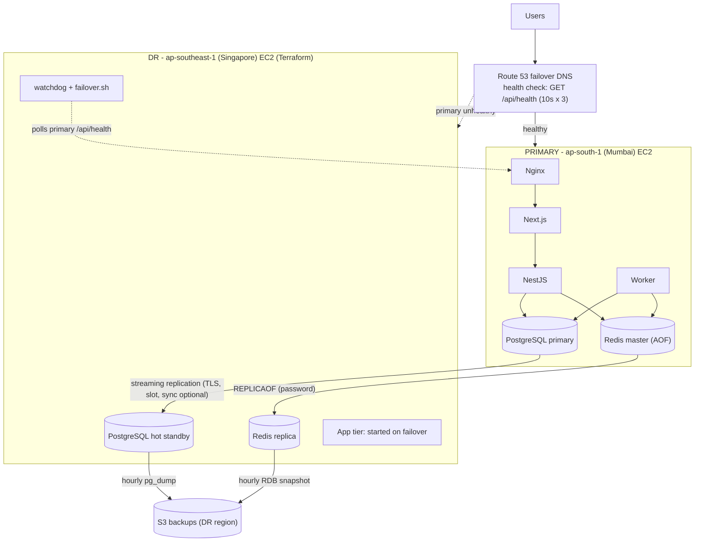

# Disaster Recovery & Business Continuity

Builds on the Round-1 stack (Next.js, NestJS, PostgreSQL 16, Redis 7 + BullMQ worker, Nginx on AWS EC2).
If the primary region/host is lost, traffic fails over to a warm standby in a second AWS region with **zero Postgres data loss** (synchronous mode) and minimal downtime.

## Architecture

| Layer | Mechanism |
|---|---|
| PostgreSQL | Physical streaming replication to a hot standby in the DR region, TLS-encrypted, replication slot (no WAL gaps). Optional synchronous commit for RPO = 0 |
| Redis / BullMQ | `appendonly yes` on master; DR runs `REPLICAOF` the master; queued jobs are replicated |
| Persistent volumes | `postgres_data` and `redis_data` are the only stateful volumes; both are replicated live and backed up hourly to S3 (DR region, versioned, encrypted, 14-day lifecycle) |
| Traffic routing | Route 53 failover records (PRIMARY with health check, SECONDARY = DR), TTL 30s |
| Failover trigger | Route 53 flips DNS; the DR `watchdog` (systemd) promotes Postgres/Redis and starts the app tier. Can be set to manual with `AUTO_FAILOVER=false` |
| IaC | Terraform (`terraform/`): DR VPC rules, EC2 + Elastic IP, IAM role, S3 bucket, Route 53 health check + records, and primary SG rules |
| Orchestration | `scripts/` (failover, failback, verify, measure) and the manual GitHub Actions workflow `DR Drill` |

## Objectives

| Metric | Target | How it is achieved | Measured (fill in after your drill) |
|---|---|---|---|
| **RPO** (data loss) | **0** for PostgreSQL with sync replication on; seconds with async | `synchronous_standby_names` = standby; commits are acknowledged only after the DR standby has them | ____ rows lost (`verify-data.sh`) |
| **RTO** (downtime) | **<= 5 min** | Route 53 detection (10s x 3 = ~30s) + DNS TTL (30s) + watchdog threshold + promotion and app start (~60-90s) | ____ s (`measure-rto.sh`) |

Notes on honesty of these numbers:
- Redis replication is asynchronous. A job accepted in the last milliseconds before the crash exists in PostgreSQL (status `WAITING`) but may be missing from the replicated queue. Postgres is the source of truth; such jobs can be re-queued with a reconcile query (listed under limitations).
- Jobs that were `PROCESSING` at crash time are recovered by BullMQ's stalled-job handling.
- Lower `WATCHDOG_THRESHOLD` (default 6 checks x 10s) to shorten RTO; higher values reduce false failovers.

## Components in this repo

| Path | Purpose |
|---|---|
| `dr/compose.primary.yml` | Overlay for the primary: WAL/replication settings, TLS, published 5432/6379, Redis password + AOF |
| `dr/compose.standby.yml` | Overlay for the DR host: standby entrypoint, Redis replica, app tier in profile `app` |
| `dr/standby-entrypoint.sh` | `pg_basebackup` bootstrap and standby start |
| `dr/dr-watchdog.service` | systemd unit for auto-failover |
| `scripts/*.sh` | Setup, failover, failback, verification and measurement (see runbook) |
| `terraform/` | DR infrastructure as code |
| `.github/workflows/dr-drill.yml` | Manual pipeline: simulate-outage, failover, failback, verify |

The overlays are selected with `COMPOSE_FILE` in each host's `.env`, so the existing CI/CD deploy (`docker compose up -d`) keeps working unchanged on the primary.

## Security

- Replication uses `hostssl` + `scram-sha-256`, limited to the two host IPs; security groups only allow 5432/6379 from the peer's IP.
- Redis requires a password; secrets live only in each host's `.env` (never in Terraform or git).
- DR EC2: IMDSv2 only, encrypted EBS, SSH restricted to your IP, S3 bucket private/encrypted/versioned.
- Limitation: certificates are self-signed and not verified (`sslmode=require`: encrypted, not authenticated). Production would use VPC peering/PrivateLink or `verify-full`.

## Limitations / next steps

- Single instance per region (no HA inside a region).
- Auto-failover is based on one observer (DR host); a cross-region network partition could cause a false failover (split-brain risk). Mitigation: `AUTO_FAILOVER=false` for manual approval, or add a quorum witness.
- Managed alternatives for production: RDS cross-region read replica / Aurora Global Database, ElastiCache Global Datastore, ALB + Global Accelerator.
- Reconcile query for jobs lost from the Redis queue (run on the new primary if needed):
  `SELECT id, task FROM jobs WHERE status = 'WAITING' AND created_at < now() - interval '1 minute';` then re-submit.
