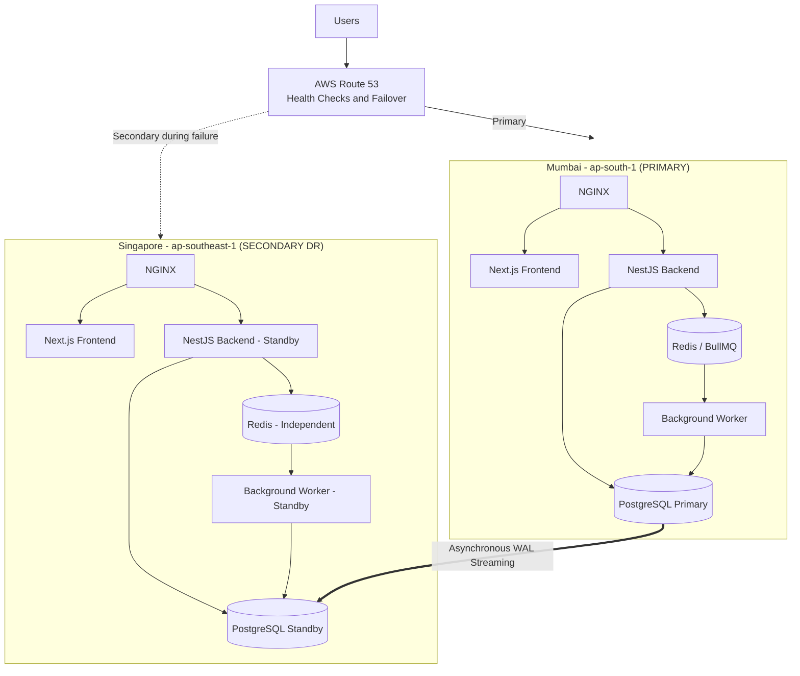

# VEGAH Multi-Region Disaster Recovery Architecture

## 1. Overview

The VEGAH application uses a multi-region disaster recovery
architecture on AWS.

- Mumbai (ap-south-1) is the PRIMARY region.
- Singapore (ap-southeast-1) is the SECONDARY DR region.
- Normal application traffic is served from Mumbai.
- Singapore is maintained as a standby environment.
- Route 53 manages primary and secondary traffic routing.

## 2. High-Level Architecture

## 3. Primary Region - Mumbai

Region: ap-south-1

Responsibilities:

- Serve normal user traffic.
- Process application requests.
- Store application data in PostgreSQL.
- Manage background jobs through Redis and BullMQ.
- Execute background jobs using the worker service.
- Provide application access through NGINX.

## 4. Secondary DR Region - Singapore

Region: ap-southeast-1

Responsibilities:

- Maintain a PostgreSQL standby replica.
- Receive asynchronous WAL replication from Mumbai.
- Maintain standby application infrastructure.
- Keep backend and worker services stopped during standby.
- Activate application services during disaster recovery.
- Serve traffic after successful failover and validation.

## 5. Database Replication

PostgreSQL asynchronous streaming replication is configured
from Mumbai to Singapore.

Normal operation:

Mumbai PostgreSQL Primary
        |
        | WAL Streaming
        v
Singapore PostgreSQL Standby

The Singapore standby remains read-only until promotion.

Asynchronous replication can result in non-zero data loss
if the primary fails before all WAL records reach the standby.

## 6. Traffic Management

AWS Route 53 is configured with:

- Mumbai as the primary endpoint.
- Singapore as the secondary endpoint.
- Health checks for regional traffic management.
- Failover routing when the primary endpoint is unhealthy.

DNS propagation and health-check intervals can affect
the time required to redirect traffic.

## 7. Failover Flow

1. Detect Mumbai primary-region failure.
2. Verify application and database availability.
3. Confirm failover conditions.
4. Stop the Mumbai primary instance when required.
5. Promote Singapore PostgreSQL standby.
6. Verify database write availability.
7. Start Singapore backend and worker services.
8. Validate Redis availability.
9. Enable Singapore NGINX readiness.
10. Submit and verify a test job.
11. Route traffic to Singapore.

## 8. Failback Flow

1. Verify Mumbai infrastructure readiness.
2. Stop new writes and workers in Singapore.
3. Verify database consistency and WAL positions.
4. Restore Mumbai as the writable primary.
5. Start Mumbai application services.
6. Validate Redis and job recovery.
7. Verify application health.
8. Restore normal Route 53 primary routing.
9. Submit a test job and verify completion.

## 9. Data Resilience Considerations

| Component | Strategy | Limitation |
|---|---|---|
| PostgreSQL | Asynchronous streaming replication | Non-zero RPO possible |
| Redis | Separate regional instances | No continuous cross-region synchronization |
| Docker volumes | Persistent local storage | Requires backup and restore procedures |
| Traffic | Route 53 failover | DNS propagation delay |

## 10. Recovery Objectives

| Metric | Current result |
|---|---|
| Measured RTO | Approximately 29 minutes 21 seconds |
| Exact RPO | Not measured |
| Replication mode | Asynchronous |
| Failover test | Completed |
| Failback test | Completed |

The RTO is based on a controlled test from Mumbai PostgreSQL
container shutdown to successful test-job completion in Singapore.

It is not a guaranteed production recovery time.

## 11. Related Documentation

- `infra/DR-IMPLEMENTATION.md`
- `infra/DATA-RESILIENCE.md`
- `infra/DR-TEST-REPORT.md`
- `infra/FAILBACK-RUNBOOK.md`
- `infra/scripts/failover.sh`
- `infra/scripts/failback.sh`
- `infra/terraform/README.md`

